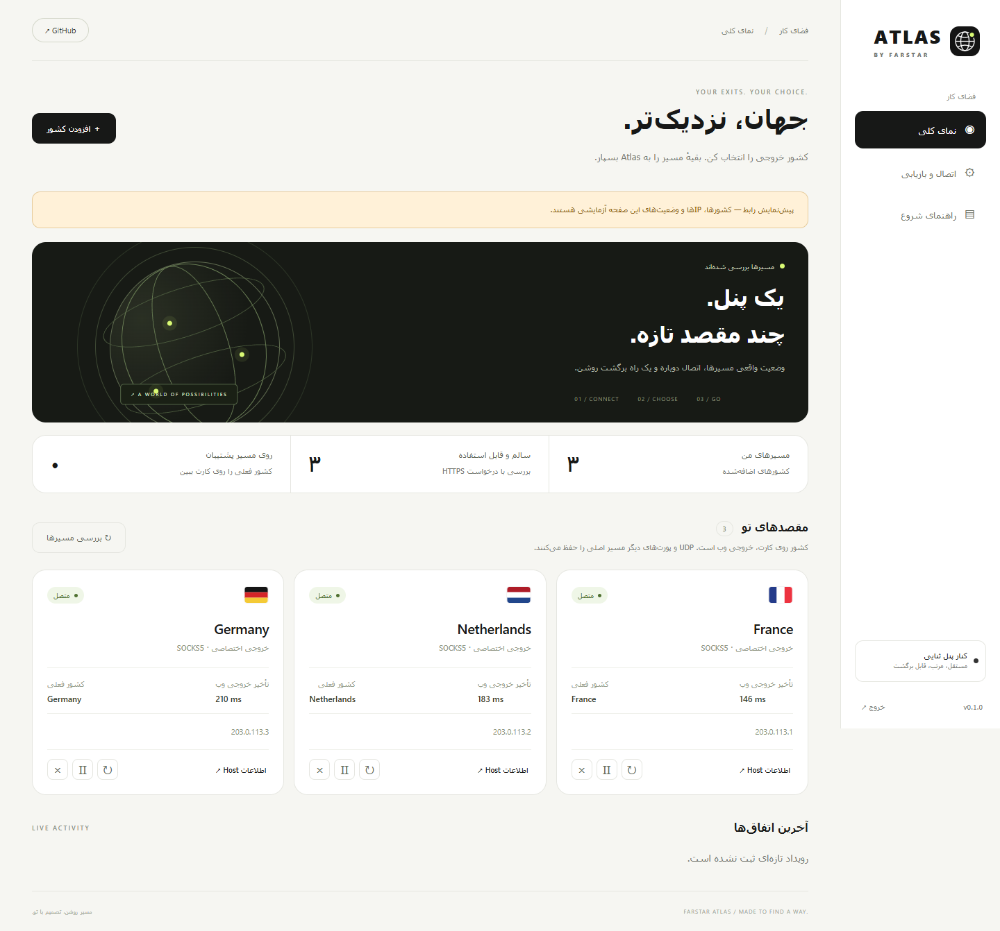

<div align="center">


# ATLAS

**مسیرهای تو، یک‌جا.**

انتخاب کشور خروجی برای پنل ثنایی، با یک رابط ساده و مستقل.

[شروع سریع](#نصب) · [آموزش Host](docs/hosts.fa.md) · [نحوهٔ کار](docs/architecture.md) · [English](README.en.md)

</div>



> تصاویر بالا پیش‌نمایش رابط با داده‌های آزمایشی‌اند؛ وضعیت زندهٔ یک سرویس عمومی نیستند.

Atlas کنار **3x-ui ثنایی** نصب می‌شود. یک کشور و اینباند موجود را انتخاب می‌کنی؛ Atlas یک ورودی مستقل می‌سازد و اوتباند و قانون مسیر آن را داخل پنل ثبت می‌کند. سپس با ساخت یک **Host** در خود پنل، همان کشور به اشتراک کاربران اضافه می‌شود.

کاربران از همان UUID و حجم قبلی استفاده می‌کنند. اوتباندهای فعلی، اینباند اصلی و تنظیمات مصرف کاربران بازنویسی نمی‌شوند.

## چه چیزهایی آماده است؟

- رابط فارسی، راست‌به‌چپ و سازگار با موبایل؛ طراحی سفید و مشکی.
- خروجی **SOCKS5 متعلق به خودت**، با پشتیبانی از نام کاربری و رمز.
- موتور رسمی **Psiphon** برای استفادهٔ شخصی یا دارای مجوز، با انتخاب کشور و اتصال دوباره.
- ثبت خودکار اوتباند و قانون مربوط در API بومی پنل، بدون ویرایش سورس ثنایی.
- بررسی دوره‌ای HTTPS واقعی، نمایش IP، کشور تأییدشده و تأخیر خروجی.
- پشتیبان SOCKS اختیاری؛ خروج از اینترنت خود سرور فقط با انتخاب صریح مدیر.
- پشتیبان محلی قبل از تغییر، تشخیص عملیات نیمه‌تمام و بازیابی همان منابع Atlas.
- اطلاعات آمادهٔ Host برای هر کشور و [آموزش کامل ساخت آن](docs/hosts.fa.md).

**Host به‌صورت خودکار به اشتراک اضافه نمی‌شود.** این مرحله یک بار در خود پنل انجام می‌شود. ورودی تازه هم باید از اینترنت یا تونل ایران به این سرور قابل دسترسی باشد؛ Atlas تونل ایران–خارج را ایجاد یا تعمیر نمی‌کند.

## پیش‌نیازها

| مورد | پشتیبانی نسخهٔ 0.1.0 |
|---|---|
| سیستم‌عامل | Debian 12+ یا Ubuntu 22.04+ با systemd و Python 3.10+ |
| پنل | نصب بومی 3x-ui؛ API نسخهٔ **3.11.0** مبنای تست است |
| محل نصب | **همان سروری که پنل و Xray روی آن هستند** |
| اینباند | VLESS، VMess، Trojan یا Shadowsocks با ورودی TCP روی IPv4 |
| پردازنده | خروجی SOCKS: amd64/arm64؛ موتور آمادهٔ Psiphon: فقط Linux amd64 |
| دسترسی پنل | URL کامل، گواهی HTTPS معتبر و توکن API با scope برابر Admin |
| API هسته | HandlerService و RoutingService فعال و پاسخ‌گو |

پنل Docker و نسخه‌های قدیمی فاقد API تنظیمات/محدودیت IP در این انتشار پشتیبانی نمی‌شوند. نسخه‌های آینده باید دوباره تست شوند؛ مستقل‌بودن افزونه به معنی تضمین سازگاری با هر تغییر API نیست. اگر قابلیت لازم پیدا نشود، Atlas تغییر را متوقف می‌کند.

## نصب

روی **سرور پنل** با root اجرا کن:

```bash
bash <(curl -fsSL https://raw.githubusercontent.com/farstar-team/atlas/main/install.sh)
```

نصب‌کننده Python و curl موردنیاز را بررسی می‌کند، یک نسخهٔ کامل از یک commit مشخص می‌گیرد، SHA-256 فایل‌ها را بررسی و سرویس مستقل `farstar-atlas` را نصب می‌کند. **رمز Atlas یک بار در خروجی نصب نمایش داده می‌شود؛ آن را نگه دار.**

پنل مدیریت Atlas در حالت پیش‌فرض فقط روی `127.0.0.1:9786` باز است. روی کامپیوتر خودت، در PowerShell یا Terminal این دستور را اجرا کن؛ آدرس و پورت SSH سرور خودت را جایگزین کن:

```bash
ssh -L 9786:127.0.0.1:9786 root@YOUR_SERVER -p YOUR_SSH_PORT
```

تا وقتی این اتصال باز است، در مرورگر کامپیوترت **http://127.0.0.1:9786** را باز کن و با رمز Atlas وارد شو. همین روش برای دسترسی مدیریت است؛ ورودی‌های VPN کشورها جداگانه روی سرور باز می‌شوند.

برای دامنه و HTTPS عمومی Atlas، [راهنمای دسترسی مدیریت](docs/operations.fa.md#دسترسی-عمومی-با-https) را ببین. بازکردن HTTP مدیریت روی اینترنت مجاز نیست.

## اولین کشور را اضافه کن

1. در پنل ثنایی، **تنظیمات ← توکن‌های API**، یک توکن جدا با دسترسی **Admin** بساز.
2. در Atlas، **اتصال و بازیابی**، URL کامل پنل همراه مسیر مخفی و توکن را وارد کن. «بررسی و ذخیرهٔ اتصال» را بزن.
3. **افزودن کشور** را بزن. کشور، خروجی SOCKS خودت و اینباند فعلی را انتخاب کن. پورت ورودی تازه باید آزاد باشد؛ خالی‌گذاشتن یعنی انتخاب خودکار.
4. «ساخت مسیر» را بزن. منتظر بررسی کشور و IP روی کارت بمان. سبزشدن یعنی درخواست HTTPS واقعی از خروجی پاسخ گرفته، نه صرفاً بازبودن پورت.
5. **اطلاعات Host** را باز کن. [طبق آموزش](docs/hosts.fa.md) یک Host برای همان اینباند با پورت تازه بساز. کاربران اشتراک Happ را به‌روزرسانی کنند.

برای Psiphon، اول در **اتصال و بازیابی** شرایط استفاده را بخوان و موتور را نصب کن؛ سپس در فرم کشور Psiphon را انتخاب کن. دانلود از مخزن رسمی با commit و SHA-256 مشخص انجام می‌شود. موتور و وضعیت آن خارج از پوشهٔ برنامه نگه‌داری می‌شوند.

### دربارهٔ Psiphon و پایداری

شبکهٔ عمومی Psiphon طبق [شرایط رسمی](https://psiphon.ca/terms) برای افراد است و ارائه یا فروش دسترسی آن به دیگران، حتی رایگان، بدون توافق با ارائه‌دهنده مجاز نیست. برای سرویس مشتریان از **خروجی خودت یا سرویس دارای مجوز** استفاده کن. مجوز متن‌باز نرم‌افزار با مجوز استفاده از شبکه یکسان نیست.

دکمهٔ اتصال دوباره از سازوکار خود موتور برای پیدا‌کردن مسیر در دسترس استفاده می‌کند؛ رنج IP اسکن نمی‌کند و **IP تازه در هر بار، کشور همیشه در دسترس، سرعت مشخص یا پایداری صددرصد** را تضمین نمی‌کند. موفقیت امروز هم دلیل اتصال در قطعی کامل اینترنت ایران نیست.

تست سلامت حدوداً هر ۲۰ ثانیه، به‌علاوهٔ زمان درخواست‌ها، انجام می‌شود. مسیر پشتیبان فقط اگر خودش پاسخ سالم بدهد برای **اتصال‌های تازه** انتخاب می‌شود؛ اتصال‌های باز منتقل نمی‌شوند و ممکن است قطع شوند. کشور واقعی پشتیبان روی کارت نمایش داده می‌شود.

### محدودهٔ تغییر مسیر

این انتشار فقط **وب TCP روی پورت مقصد 80 و 443** را از کشور انتخاب‌شده عبور می‌دهد. ترافیک UDP، تماس واتساپ، بازی و سایر پورت‌ها مسیر موجود پنل را حفظ می‌کنند. پشتیبانی IPv6 خروجی به فراهم‌کننده بستگی دارد و تست سلامت این نسخه آن را تأیید نمی‌کند. پرچم کشور به معنی انتقال همهٔ ترافیک به آن کشور نیست.

WireGuard داخلی، ساخت خودکار Host، چند سرور مستقل، تست از اپراتورهای ایران و تضمین دسترسی در قطعی سراسری در این نسخه وجود ندارند. اگر WireGuard خودت را داری، می‌توانی یک SOCKS محلی روی آن مسیر به Atlas بدهی؛ Atlas فایل‌های WireGuard را مدیریت نمی‌کند.

## به‌روزرسانی و حذف

برای به‌روزرسانی، همان دستور نصب را دوباره اجرا کن. تنظیمات، رمز، موتور و پشتیبان‌ها در `/var/lib/farstar-atlas` حفظ می‌شوند. فقط سرویس Atlas دوباره اجرا می‌شود؛ **جریان‌های فعال متعلق به خود Atlas ممکن است دوباره متصل شوند**. نصب‌کننده دستور restart برای x-ui یا Xray صادر نمی‌کند.

تغییر اوتباند و routing از مسیر رسمی پنل انجام می‌شود. روی نسخهٔ تست‌شده این تغییرها به‌صورت زنده اعمال شدند. اگر API هسته خطا بدهد، خود پنل ممکن است به راه‌اندازی مجدد برگردد؛ هیچ ادعای قطع‌نشدن مطلق وجود ندارد.

برای حذف:

```bash
bash /opt/farstar-atlas/current/uninstall.sh
```

ابتدا منابع متعلق به Atlas از پنل جدا می‌شوند؛ اگر این مرحله ناموفق شود، حذف متوقف و سرویس دوباره اجرا می‌شود. کاربران و قواعد دیگر حذف نمی‌شوند. Hostهایی را که خودت ساخته‌ای در پنل حذف کن. تنظیمات و پشتیبان‌ها برای بازیابی روی سرور باقی می‌مانند.

[عملیات، تغییر رمز و عیب‌یابی](docs/operations.fa.md) · [گزارش تست و محدودیت‌ها](docs/validation.md) · [امنیت](SECURITY.md)

## توسعه و تست

هستهٔ برنامه فقط از کتابخانهٔ استاندارد Python و curl استفاده می‌کند؛ Node یا npm روی سرور لازم نیست.

```bash
python3 -m unittest discover -s tests -p 'test_*.py' -v
```

تست مرورگر و تست اختیاری پنل واقعی در [راهنمای توسعه](docs/development.md) توضیح داده شده‌اند. داده‌های عکس‌ها آزمایشی‌اند؛ گزارش تست عمومی شبکه از تست محلی TLS جداست.

## مجوز

کد Atlas با [MIT](LICENSE) منتشر شده است. مجوزها و شرایط وابستگی‌ها مستقل‌اند؛ [منابع ثالث](THIRD_PARTY.md) را ببین.
