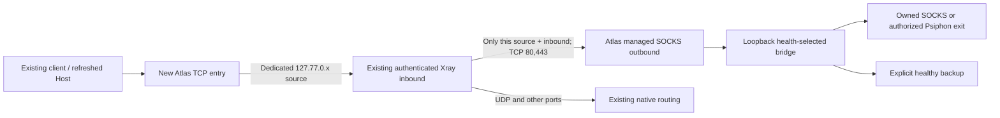

# Architecture and compatibility contract

Atlas is an independent Python standard-library daemon. Its runtime uses the native API, never opens panel SQL, rewrites upstream code, edits existing inbound credentials, resets traffic counters, or installs a statistics gateway. During installation only, it reads a fixed set of web settings from SQLite/local PostgreSQL or existing ZARIB metadata. SQL discovery is read-only and creates no roles or tokens.

## Public access and native login (0.2.0)

The default public IPv4 listener uses a dedicated port (9786, with free-port alternatives) and `<native-base>/atlas/`, preserving native cookie path scope. Static assets/API requests use relative paths. Public Host aliases are discovered explicitly; arbitrary Host and Origin values remain rejected. A custom public port is included in activation health checks.

Existing native cookies are revalidated through the local native panel for every protected request. For a new device, Atlas obtains native pre-login CSRF, forwards username/password/optional TOTP to native `/login`, validates the returned cookie and sets the same host-only native cookie in the browser. Passwords and TOTP codes are not persisted. Background Admin tokens cannot substitute for browser authentication. Atlas CSRF is an HMAC of native cookie and public origin; native logout/revocation is reflected on the next request. Atlas logout expires both native base-path and legacy root cookies on the current host.

The service inherits the native HTTP/HTTPS scheme. Root-owned access metadata and restricted certificate copies live under `/etc/farstar-atlas`. A root certificate-sync oneshot/timer validates the original pair, refreshes the copies and leaves source permissions unchanged. The unprivileged daemon reloads valid TLS pairs for new handshakes without restarting; a transient mismatched renewal retains the prior context. Domain-only certificates do not automatically cover IP aliases. `--private` explicitly opts back into legacy loopback/password access.

## Isolation and accounting

The public entry forwards raw TCP to the existing native inbound. It does not terminate VLESS/TLS/Reality or expose an unauthenticated Internet proxy. Xray still authenticates the original user, enforces the original quota, and owns native traffic accounting. Each entry has a distinct source address; the managed rule matches both this source and the selected native inbound tag. Other Hosts entering the same native inbound retain their original source and route.

Rules are inserted after the leading native API/blackhole rules and before ordinary routing. Existing relative rule order and first/default outbound are preserved. Explicit custom rule layouts should be reviewed before use. Atlas controls web egress for its entries, not an entire user's device or every protocol.

Dedicated sources `127.77.0.1–32` are added to the native `ipLimitAllowlist`, preserving existing entries. They represent an internal forwarding hop, not customer devices. Therefore native simultaneous-IP counting cannot distinguish real client IPs **through Atlas entries**; quota and authentication still apply. Ordinary direct entries retain their existing behavior. Atlas does not disable the jail or globally allow external sources. Existing third-party bans need operator review; safe reserved addresses are deliberately separate from previously used relay addresses. The local allowlist entries remain after detach/rollback to avoid a delayed jail banning internal hops.

## Native API surface, tested on 3.11.0

| Purpose | Endpoint under `<base>/panel/api/` |
|---|---|
| Read filtered native inbound metadata | `GET inbounds/list` |
| Read template | `POST xray/` (obj contains a JSON string wrapper) |
| Persist and hot-reconcile template | `POST xray/update` (form `xraySetting`, `outboundTestUrl`) |
| Verify RoutingService responds | `POST xray/routeTest` |
| Preserve and extend trusted local sources | `POST setting/all`, `POST setting/update` |

Only `atlas-<random-id>` outbounds and matching `ruleTag` resources recorded in local state are managed. The template guard rejects edits to DNS, inbounds, policy, users and foreign outbounds. The native settings view redacts secrets; its update API preserves redacted blank secrets. Atlas round-trips the view when extending the IP allowlist, excluding response-only presence flags.

The official `xray/update` endpoint saves the template and asks the panel to reconcile the core. Ordinary outbound/routing changes were hot-applied in our integration test. **The native implementation can fall back to a core restart after hot-API failure.** Atlas does not claim to prevent that or directly invoke a panel/core restart. Enabling API services or changing unrelated template sections must be done separately by the operator.

## Transactions and recovery

1. Serialize Atlas writes.
2. Read the current template and privately back up current route definitions/config/template.
3. Write `pending.json` before side effects.
4. Start/bind required listeners and provider processes.
5. Extend native trusted-source allowlist.
6. Re-read and compare the template before writing; abort if another edit is visible.
7. Submit the scoped template once; do not blindly retry an ambiguous write.
8. Read back managed rules/outbounds, persist Atlas state, remove the journal.

On failure, rollback merges previous Atlas route definitions into **the current template**, preserving unrelated changes. A failed rollback retains the journal for the recovery action. Backups restore Atlas route definitions, not historical passwords or all panel state. A crash can leave a partially applied route until the operator recovers it; the UI shows the pending operation and blocks further managed changes.

The native API provides no transactional revision precondition. A narrow external edit race remains between the final read and write; do not edit the same Xray template concurrently in Atlas and the panel. Multiple Atlas instances must not share one panel. Restoration of altered Atlas resources by another editor is likewise outside the ownership contract.

## Providers and failover

The official Psiphon ConsoleClient runs as a child of the unprivileged Atlas systemd service. It binds a loopback SOCKS port, keeps its own per-route discovery cache, and chooses available servers through its native mechanism. The reviewed Linux x86_64 asset is pinned to a commit and SHA-256 in `providers/psiphon.json`. No binary is bundled in this repository, and no range scanner is included.

Health probes make a validated HTTPS request through each primary provider to Cloudflare's trace endpoint, require a syntactically valid IP and matching requested country, and show cold request duration. This value is **not** an end-user ping or full tunnel throughput. Backup probes show their actual country instead of relabelling it. This release uses one probe destination; an outage or country-classification error there can create a false negative.

The loopback SOCKS bridge picks only a verified primary, explicit healthy backup or explicitly permitted direct server exit. Default behavior fails closed when none is healthy. Checks run sequentially per route with up to four routes in parallel, then a 20-second interval. Each request can take up to 12 seconds; recovery is not instantaneous. Failed Psiphon paths are retried through engine reconnection after a three-minute cooldown. No always-new IP or uninterrupted streams are promised.

Only TCP CONNECT is supported by the bridge. No SOCKS UDP ASSOCIATE is advertised. Native routing confines the bridge to destination ports 80 and 443, keeping UDP and other ports on pre-existing routes. Country classification reflects the trace service; arbitrary websites can classify the same IP differently. IPv6 egress is provider-dependent and not validated by this release.

## Updates and removals

Code lives in `/opt/farstar-atlas/releases/<version>-<manifest-hash>` with an atomic `current` symlink. Private state, credentials, engine caches, event SQLite DB and backups live in `/var/lib/farstar-atlas`. The service runs as `farstar-atlas` with read-only system files and no root privileges. Entry ports are deliberately restricted to 1024–60999, avoiding a privileged bind capability.

Updates validate a complete staged source, atomically switch releases, restart only Atlas and check its admin HTTP health. Failed activation restores the prior code/unit. State schema 1 has no destructive migration. Atlas connection streams may reconnect during its own restart. Upstream 3x-ui updates do not overwrite Atlas code; breaking native API changes may still require an Atlas update.

Uninstall stops Atlas, detaches managed resources through the API, and removes the service/launcher only after success. State/code/backups are retained. User-created native Hosts remain the operator's responsibility.
