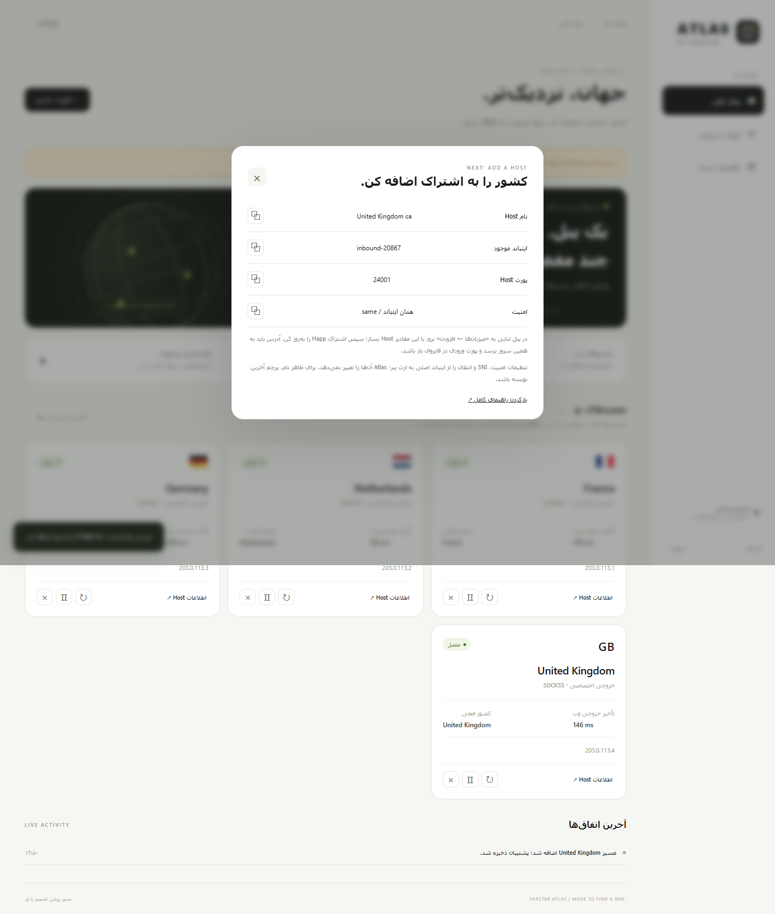

# کشور تازه را چطور به اشتراک اضافه کنم؟

Atlas اوتباند و مسیر را خودکار می‌سازد. **Host** مشخص می‌کند کاربر از کدام آدرس و پورت وارد آن مسیر شود. ساخت Host در این انتشار، یک مرحلهٔ دستی در خود پنل ثنایی است.

در مثال زیر پنل و Atlas روی سرور خارجی هستند. هیچ IP واقعی یا اطلاعات کاربر لازم نیست منتشر کنی.

## ۱. اول سالم‌بودن کشور را بررسی کن

در Atlas، کارت کشور باید وضعیت «متصل» داشته باشد. کشور فعلی را هم ببین؛ اگر پشتیبان فعال است، ممکن است با کشور انتخابی متفاوت باشد.

اگر کارت «در دسترس نیست» یا «در حال بررسی» است، اضافه‌کردن Host مشکل خروجی را حل نمی‌کند. ابتدا آدرس خروجی، رمز SOCKS یا دسترسی موتور را بررسی کن.

## ۲. اطلاعات Host را از کارت بگیر

روی **اطلاعات Host** بزن. این موارد نمایش داده می‌شوند:

| مورد | مثال |
|---|---|
| نام | `France 🇫🇷` |
| اینباند موجود | همان اینباندی که موقع ساخت کشور انتخاب کردی |
| پورت Host | مثلاً `20001`؛ مقدار واقعی را از کارت بردار |
| امنیت | همان تنظیمات اینباند / `same` |

این عکس خود پنل ثنایی نیست؛ راهنمای مقادیری است که Atlas به تو می‌دهد.

## ۳. وارد بخش میزبان‌های ثنایی شو

در منوی پنل **میزبان‌ها / Hosts** را باز کن و **افزودن** را بزن. در نسخهٔ 3.11.0 فرم Host، بخش **پایه** محل اصلی تنظیم این موارد است. ترجمه یا جای گزینه‌ها در نسخه‌های بعدی ممکن است فرق کند.

## ۴. Host را با این مقادیر بساز

1. **اینباندها:** همان اینباندی که در Atlas انتخاب شده است. یک اینباند تازه با کاربرهای تازه نساز.
2. **نام / Remark:** مثلاً `France 🇫🇷`. نام کشور را انگلیسی بنویس و پرچم آخرین نویسه باشد تا Happ آن را درست نمایش دهد. اگر چند مسیر یک کشور داری، مثل `IR1 France 🇫🇷` و `Direct France 🇫🇷` متمایزشان کن.
3. **آدرس‌ها / Hosts:** IP یا دامنه‌ای که واقعاً به **ورودی Atlas** می‌رسد؛ مثلاً IP سرور خارجی. **IP خروجی Psiphon را اینجا نگذار.** آن IP محل ورود کاربران تو نیست.
4. **پورت:** پورت تازه‌ای که Atlas روی کارت نشان داده؛ پورت اینباند اصلی را به‌جای آن نگذار.
5. **Security / امنیت:** حالت **همان اینباند / same / ارث‌بری** را نگه دار. اگر اینباند Reality دارد همان پارامترها لازم است؛ اگر TLS دارد، SNI و گواهی باید همچنان با اینباند اصلی معتبر باشند. Atlas لایهٔ TLS یا Reality را تغییر نمی‌دهد.
6. Host را **فعال و قابل نمایش** نگه دار و **ذخیره** را بزن.

شناسهٔ کاربر، رمز پروتکل، کلید Reality یا حجم مشتری را تغییر نده. Host از همان اینباند و کاربرهای موجود استفاده می‌کند.

## ۵. مسیر ورود را باز کن

اگر کاربر مستقیم به سرور خارجی وصل می‌شود، پورت تازه باید در فایروال همان سرور و پنل ارائه‌دهنده باز باشد.

اگر آدرس Host سرور ایران است، باید **همان پورت تازه** از تونل موجود به ورودی Atlas روی خارج برسد. بازبودن پورت اصلی تونل به معنی عبور خودکار این پورت تازه نیست. Atlas به سرور ایران SSH نمی‌زند و این تونل را ایجاد نمی‌کند.

پورت‌های داخلی `61101–61132` و `61201–61232` را عمومی نکن؛ آن‌ها متعلق به ارتباط داخلی افزونه‌اند.

## ۶. نام خروجی را در اشتراک کنترل کن

در Happ اشتراک را **Update / به‌روزرسانی** کن. گزینهٔ تازه باید ظاهر شود. فقط Refresh تست تأخیر، فهرست کانفیگ‌ها را تازه نمی‌کند.

اگر نام Host در لینک نیست یا دو گزینه هم‌نام‌اند، تنظیم نام‌گذاری اشتراک پنل را بررسی کن. قالبی که Host را شامل می‌شود مانند `{{INBOUND}} {{HOST}}` کمک می‌کند. نام اینباند و Host را طوری انتخاب کن که کشور تکرار نشود و پرچم واقعاً آخر متن نهایی قرار بگیرد.

در بعضی نسخه‌ها سرویس اشتراک تنظیم نام‌گذاری را از زمان شروع نگه می‌دارد. بنابراین **خود لینک تحویل‌شده در اشتراک Happ** را بررسی کن؛ درست‌بودن پیش‌نمایش لینک در پنل به‌تنهایی کافی نیست. Atlas برای اصلاح ظاهر نام، پنل مشتری‌دار را خودکار restart نمی‌کند و در این نسخه بازنویس اشتراک ندارد.

## ۷. اتصال واقعی را امتحان کن

به گزینهٔ تازه وصل شو. یک سایت نمایش IP باز کن و کشور خروجی وب را با کارت Atlas مقایسه کن. یک دانلود کوچک هم امتحان کن. شمارندهٔ مصرف باید روی همان کاربر پنل بالا برود؛ Atlas مصرف را جدا نمی‌کند و صفر هم نمی‌کند.

برای تماس یا بازی، توجه کن این انتشار فقط وب TCP روی 80 و 443 را جابه‌جا می‌کند. سبزشدن کارت، تست از تمام اپراتورهای ایران یا تضمین UDP نیست.

## اگر گزینه تازه وصل نشد

| نشانه | بررسی کن |
|---|---|
| کارت Atlas قرمز است | خروجی و دسترسی به کشور؛ مشکل Host نیست |
| کارت سبز است ولی Happ timeout دارد | آدرس Host، پورت تازه، فایروال و انتقال پورت از سرور ایران |
| UUID یا Reality خطا می‌دهد | Host به همان اینباند اصلی وصل باشد؛ ارث‌بری امنیت تغییر نکرده باشد |
| فقط یک اپراتور وصل نمی‌شود | مسیر همان اپراتور تا IP/پورت ورودی؛ تست محلی سرور جای آن را نمی‌گیرد |
| نام‌ها تکراری‌اند | به‌روزرسانی واقعی اشتراک و قالب شامل Host |
| کشور با نام فرق دارد | فعال‌شدن پشتیبان یا فرق کشور جغرافیایی پایگاه‌های IP؛ کشور فعلی کارت را ببین |
| بعد از حذف مسیر هنوز در Happ هست | Host دستی را در پنل هم حذف و اشتراک را به‌روز کن |
